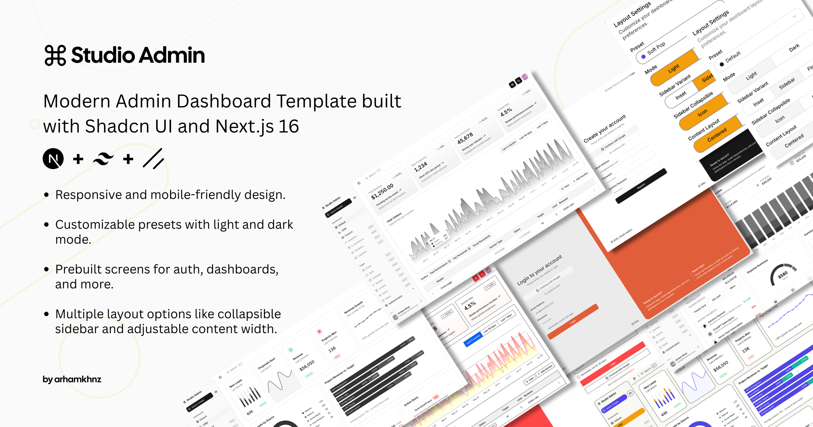

# Paper Desk

**Before you trust an AI trading strategy, get a second opinion in seconds.**

You type a trading plan in plain English. Claude writes it as Python. Ten network-blocked Daytona sandboxes run it on 30 stocks. A referee then checks whether the backtest is real, and gives one verdict, **Trust**, **Be careful** or **Do not trust**, with plain reasons. When the code peeks at the future, a red stamp names the line that did it.

Built at the Daytona HackSprint (with Arize AI), NYC, October 16 2026.

> Paper money only. Not financial advice. Past results do not predict future results.



---

## Contents

- [The problem](#the-problem)
- [What it does](#what-it-does)
- [How it works](#how-it-works)
- [The checks](#the-checks)
- [Repo layout](#repo-layout)
- [Run it locally](#run-it-locally)
- [Environment variables](#environment-variables)
- [Using the dashboard](#using-the-dashboard)
- [API](#api)
- [Safety](#safety)
- [Limitations](#limitations)
- [Tech stack and credits](#tech-stack-and-credits)

---

## The problem

AI can write a trading strategy and a backtest in minutes. The backtest often isn't real:

- **Look-ahead bias.** The code reads tomorrow's price to decide today. The equity curve looks amazing, and none of it can be traded.
- **Training-data leakage.** The model may have seen the test period during training. One study ("Profit Mirage") found five LLM trading methods lost 50 to 72% of their return when tested after the model's training cutoff.
- **Overfitting by trial count.** Try enough variants and one looks great by luck alone.
- **Cherry-picking.** A rule that works on one stock and fails on the other 29.

Most people judge by looking at the chart. Existing checkers are libraries for quants who write code. Paper Desk gives anyone a plain-English second opinion in about 30 seconds.

## What it does

1. **Describe:** type a plan ("Buy Costco when it drops 5%, sell after 10 days") or pick an example. Pasting Python that contains `def strategy(` skips the agent.
2. **Claude writes code:** Claude turns the plan into `strategy(df) -> pd.Series` of positions.
3. **30 stocks tested:** 10 Daytona sandboxes (no internet, no keys) each run the code on 3 stocks, streaming live logs to the dashboard.
4. **Verdict:** Trust / Be careful / Do not trust, with reasons, KPIs and charts.

Then:

- **Why this verdict?** Ask a question. The answer is written only from the Arize trace of that run, and every number in it is checked against the trace. Invented numbers get flagged.
- **Fix it:** Claude writes 4 honest versions of the plan, and all 4 run in parallel on Daytona with the same checks.
- **Seal & share:** lock the verdict with a timestamp and a SHA-256 fingerprint, place a 1-share Alpaca **paper** order as a dated, third-party record, and get a shareable card at `/card/<hash>`.
- **Demo switch:** "Plant a cheating line" injects one line that reads tomorrow's close (`df["close"].shift(-1)`), to prove the checker catches it live.

## How it works

```
 Plain English plan
        │
        ▼
 Claude (claude-sonnet-5-5) ──► strategy.py
        │
        ▼
 Daytona: 10 ephemeral sandboxes from snapshot "paper-desk"
   networkBlockAll · no env vars · auto-deleted
   each runs engine/runner.py on 3 of 30 stocks
        │  live logs streamed back (session commands)
        ▼
 Referee (web/src/server/paperdesk/verdict.ts)
   peeking · locked period · breadth · trial count
        │
        ├──► Arize AX: every step traced over OTLP
        │        └── "Why?" answers grounded in the trace, numbers verified
        ├──► Fix it: 4 honest variants × 2 sandboxes each
        └──► Seal: SHA-256 hash + Alpaca paper order + share card
```

- The Next.js server holds every API key. The sandbox only gets `runner.py`, `strategy.py` and the price files baked into the snapshot.
- Without `DAYTONA_API_KEY`, the engine falls back to running `runner.py` locally from `engine/.venv` (dev only, no isolation).

## The checks

All logic lives in [`web/src/server/paperdesk/verdict.ts`](web/src/server/paperdesk/verdict.ts) and [`engine/runner.py`](engine/runner.py).

| Check | How | Outcome |
|---|---|---|
| **Peeking** | Rerun the strategy 50 times, each time with all data after a cutoff date removed. If any past decision changes, the code was reading the future. The runner also flags suspect lines (e.g. `shift(-1)`). | Any change → **Do not trust**, with the line number on the stamp. |
| **Locked period** | Data after `PAPERDESK_LOCK_DATE` (default 2026-01-01, after the model's training cutoff) is the "unseen" test. Compare Sharpe in the build period vs the locked period on the stock you named. | Build Sharpe ≥ 0.5 and locked Sharpe < 0 → fail. Locked < half of build → warn. |
| **Breadth** | Run the same rule on all 30 stocks. | Fewer than 40% with positive locked Sharpe → warn (likely cherry-picked). |
| **Trials** | Every plan tested, including Fix-it variants, increments a counter. The limit scales with data length (after Bailey and López de Prado): about 7 tries for 2 years, 45 for 5+ years. | Over the limit → warn. |

Grade: any fail → **Do not trust**. Any warn → **Be careful**. Otherwise **Trust**.

The thresholds are provisional and kept in one `THRESHOLDS` object, so they're easy to tune.

## Repo layout

```
engine/
  runner.py           Backtest + 50-cutoff peeking test + stats. Prints LOG lines and one RESULT: JSON line.
  fetch_prices.py     Downloads daily prices for the 30 tickers (Alpaca, Yahoo fallback).
  prices/             30 CSVs, daily OHLCV, 2016 to today (baked into the Daytona snapshot).
  examples/           clean.py and leaky.py strategies for testing.
web/                  Next.js 16 app (built on next-shadcn-admin-dashboard)
  scripts/snapshot.mjs                One-time: build the "paper-desk" Daytona snapshot.
  src/server/paperdesk/
    agent.ts          Claude: plan → strategy, honest variants, grounded "why", bug injection.
    engine.ts         Daytona sandboxes (or local fallback), log streaming, CPU-limit retry.
    verdict.ts        The referee: checks, thresholds, grade.
    trace.ts          Arize AX tracing over OpenTelemetry.
    run.ts            Orchestration, trial counter, JSON store, seal + Alpaca paper order.
  src/app/api/        run, verdict, fix, why, seal, trials
  src/app/(main)/dashboard/desk/      The main dashboard.
  src/app/(main)/dashboard/record/    All sealed verdicts.
  src/app/card/[hash]/                Public shareable card.
demo/                 3-minute demo script (txt and html).
```

## Run it locally

Requirements: Node 20+, Python 3.12 (only for the local fallback or refreshing prices), and accounts for Daytona, Anthropic, Arize AX and Alpaca (paper).

```bash
git clone https://github.com/rsub122/paper-desk.git
cd paper-desk/web
cp .env.example .env.local     # then fill in your own keys
npm install
```

Build the Daytona snapshot once (Python, pandas and the price files):

```bash
node --env-file=.env.local scripts/snapshot.mjs
```

Start the app:

```bash
npm run dev
```

Open http://localhost:3000/dashboard/desk.

**Optional, local engine without Daytona:** leave `DAYTONA_API_KEY` empty and create the venv the fallback uses:

```bash
cd ../engine && python3 -m venv .venv && .venv/bin/pip install pandas==2.2.3 numpy==2.1.3
```

**Optional, refresh prices:** `engine/.venv/bin/python engine/fetch_prices.py`, then rebuild the snapshot.

## Environment variables

All of these go in `web/.env.local`, which git ignores. Never commit real keys.

| Variable | Required | Purpose |
|---|---|---|
| `DAYTONA_API_KEY` | for sandboxes | Runs strategies in Daytona. Empty → local fallback. |
| `DAYTONA_SNAPSHOT` | no | Snapshot name, default `paper-desk`. |
| `PAPERDESK_SANDBOXES` | no | Sandboxes per run, default `10`. A free org has a 10 CPU limit. |
| `ANTHROPIC_API_KEY` | yes | Claude writes strategies, variants and explanations. |
| `ANTHROPIC_WORKSPACE_ID` | for org keys | Sent as the `anthropic-workspace-id` header. |
| `PAPERDESK_MODEL` | no | Default `claude-sonnet-5-5`. |
| `PAPERDESK_LOCK_DATE` | no | Start of the locked period, default `2026-01-01`. |
| `ARIZE_SPACE_ID` | for tracing | Arize AX space ID (keep the `==` padding). |
| `ARIZE_API_KEY` | for tracing | Arize AX API key. |
| `ARIZE_PROJECT_NAME` | no | Default `paper-desk`. |
| `ALPACA_API_KEY` | for seal | Alpaca **paper** key. |
| `ALPACA_SECRET_KEY` | for seal | Alpaca **paper** secret. Orders only go to `paper-api.alpaca.markets`. |

## Using the dashboard

`/dashboard/desk` reads top to bottom:

1. **Step strip:** Describe → Claude writes code → 30 stocks tested → Verdict.
2. **Your plan:** type a plan or pick an example. Toggle **Demo: plant a cheating line** to inject a look-ahead bug. Press **Test my plan**.
3. **Verdict card:** grade, what it means, backtest vs buy-and-hold, reasons, and buttons for *Why*, *Fix it* and *Seal & share*.
4. **KPIs:** build-period return and Sharpe, unseen-data result, Daytona timing, plans tested so far (with reset).
5. **Tabs:**
   - **Live run:** one terminal per sandbox, streaming real output.
   - **Charts:** price with trades, equity vs buy-and-hold, and results across all 30 stocks.
   - **Why & code:** the generated code (leaking line highlighted) and a grounded Q&A with a "numbers match the trace" badge.
   - **Fix it:** 4 honest variants run in parallel, with build, locked and verdict per row.
   - **Seal & share:** hash, paper order status and the share card link.

`/dashboard/record` lists every sealed verdict. `/card/<hash>` is the public card.

A 3-minute demo walkthrough is in [`demo/demo-script.txt`](demo/demo-script.txt).

## API

All routes are under `web/src/app/api/`.

| Route | Body | Returns |
|---|---|---|
| `POST /api/run` | `{ plan, injectBug? }` | Streaming NDJSON: stage, sandbox, log and ticker events, then the report. |
| `POST /api/verdict` | `{ plan, injectBug? }` | The full report as JSON (non-streaming). |
| `POST /api/fix` | `{ plan }` | 4 honest variants, each with its own report. |
| `POST /api/why` | `{ runId, question }` | Answer grounded in the run's trace, plus a number check. |
| `POST /api/seal` | `{ runId }` | Seal record: hash, timestamp, Alpaca paper order. |
| `GET /api/seal` | | All seals. |
| `GET /api/trials` | | Trial counter. |
| `DELETE /api/trials` | | Reset the trial counter. |

Example:

```bash
curl -s localhost:3000/api/verdict -H 'content-type: application/json' \
  -d '{"plan":"Buy Costco when it drops 5% in a day, sell after 10 trading days"}' | jq '.grade, .reasons'
```

Add `# ticker: COST` to pasted code to pick the focus stock.

## Safety

- **Untrusted code is isolated.** Strategies run in ephemeral Daytona sandboxes with all network access blocked and no environment variables or keys. Sandboxes are deleted after each run.
- **Paper money only.** The Alpaca URL is hard-coded to `https://paper-api.alpaca.markets`. There is no live-trading path.
- **Keys stay on the server.** They're read from `web/.env.local`, which is git-ignored, and never sent to the browser or the sandbox.
- **Grounded explanations.** "Why" answers come only from the recorded trace, and each number is checked against it.
- **Not financial advice.** Paper Desk judges whether a backtest is trustworthy. It does not recommend trades.

## Limitations

- **Survivorship bias:** the 30 stocks are today's large caps, so every backtest is somewhat optimistic.
- **Provisional thresholds:** the cutoffs in `verdict.ts` are reasonable defaults, not tuned research values.
- **Local demo storage:** runs live in memory (lost on restart). Seals and the trial counter live in `web/.data/store.json`. This won't work on serverless hosting without a database.
- **Daily bars only,** long/flat positions, no costs or slippage modelled.
- **The peeking test is behavioural:** it catches code whose past decisions change when the future is hidden. Leaks that don't change any decision aren't caught (and also can't inflate results).

## Tech stack and credits

- [Daytona](https://daytona.io): isolated sandboxes (`@daytonaio/sdk`)
- [Anthropic Claude](https://anthropic.com): strategy writing, variants, explanations
- [Arize AX](https://arize.com): tracing and grounded explanations (OpenTelemetry)
- [Alpaca](https://alpaca.markets): paper trading record
- Next.js 16, React 19, Tailwind CSS v4, shadcn/ui, Recharts, lightweight-charts
- Python 3.12, pandas, numpy
- Dashboard template: [next-shadcn-admin-dashboard](https://github.com/arhamkhnz/next-shadcn-admin-dashboard) (MIT, see `web/LICENSE`)
